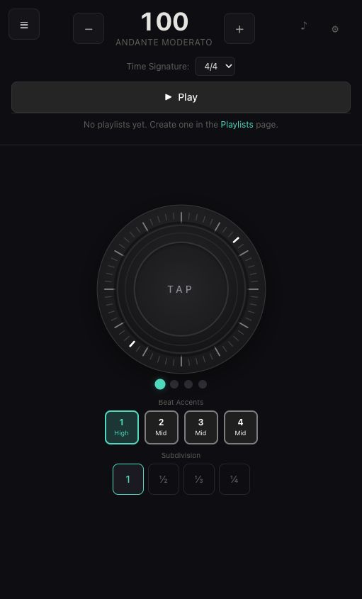
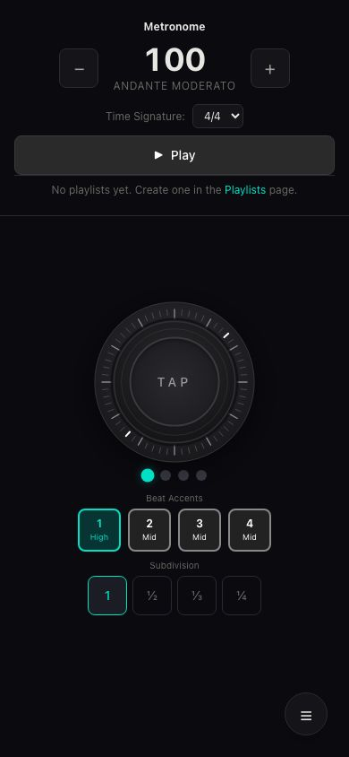
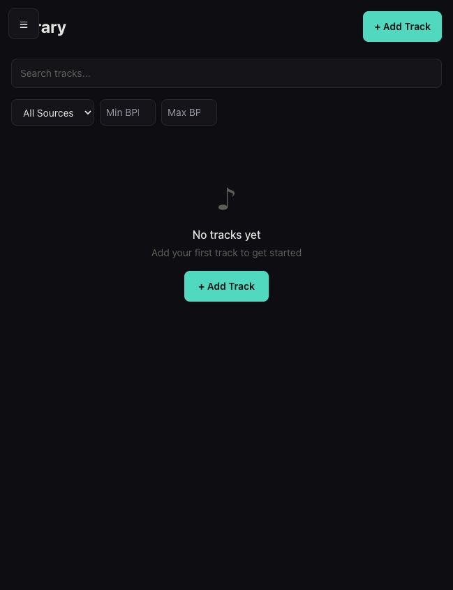
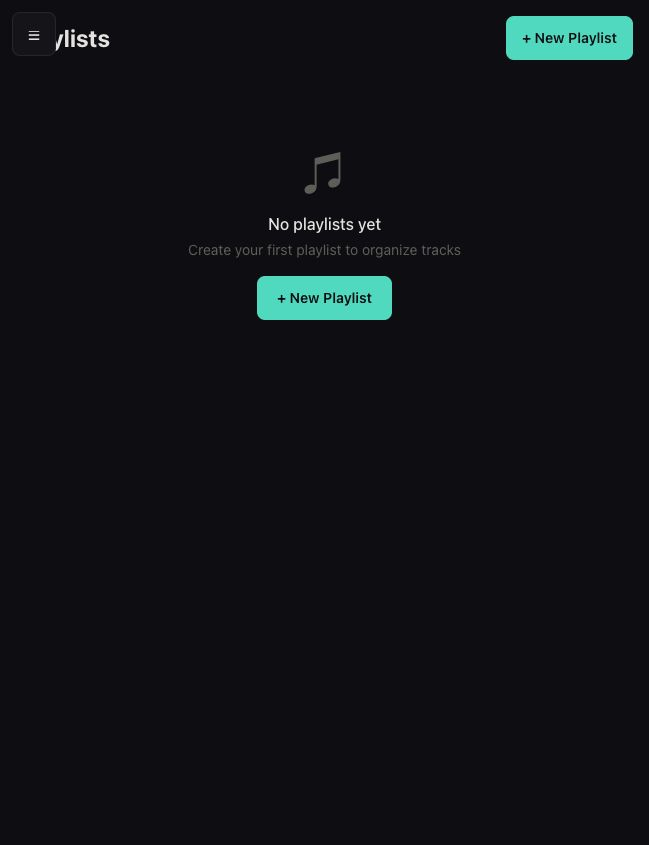

# 🎵 Metronome

A precision metronome web app for musicians — set tempo, practice with subdivisions, build track playlists, and detect BPM from YouTube videos. Pure frontend, works offline, no backend required.

## 📸 Screenshots

| Desktop | Mobile |
|---------|--------|
|  |  |

| Library | Playlists |
|---------|-----------|
|  |  |

## ✨ Features

### Metronome
- **Adjustable BPM** — Tap the dial or use +/- buttons (40–240 BPM)
- **Time signatures** — 2/4, 3/4, 4/4, 6/8
- **Subdivisions** — Quarter, eighth, triplet, and sixteenth notes
- **Beat accents** — Per-beat volume (Off / Low / Mid / High) with pitch variation
- **Sound types** — Woodblock, Beep, Click (with volume preview)
- **Visual modes** — Pendulum, flash screen, flash numbers, count-in
- **Themes** — Dark and light mode
- **Tap-tempo history** — Latest tap estimate in BPM display; recent history in Settings (clearable)

### Track Library
- **Add tracks** — YouTube URL or manual BPM entry
- **Edit tracks** — Change title, BPM, time signature, subdivision and beat accents
- **YouTube player** — Embedded player with tap-to-detect BPM
- **Status badges** — Processing, Ready, Failed, BPM needed
- **Search & filter** — By title, source (YouTube/Manual), BPM range

### Playlists
- **Create playlists** — Organize tracks into practice sets
- **Reorder tracks** — Move up/down within a playlist
- **Playlist player** — Select a playlist on the metronome page, navigate tracks, remembers the last loaded playlist and auto-syncs BPM/per-track settings
- **Rename playlists** — Double-click or use Rename button

### Design
- **Studio Instrument aesthetic** — Deep charcoal, warm ink, teal accent
- **Responsive** — Works on desktop and mobile (390px+)
- **Navigation** — Desktop sidebar Settings nav; mobile FAB speed dial (Metronome/Library/Playlists/Settings)
- **Accessible** — Focus-visible, touch targets ≥44px, reduced motion support
- **Offline-first** — All data stored in localStorage, works without internet

## 🚀 Getting Started

### Prerequisites
- Node.js 18+
- npm or yarn

### Installation

```bash
# Clone the repository
git clone https://github.com/danielfpadilla/metronome.git
cd metronome

# Install dependencies
npm install

# Start dev server
npm run dev
```

The dev server runs at `http://localhost:5173/` by default. `npm run preview` serves the production build at `http://localhost:4173/` (or `http://localhost:3000/` when started with `--port 3000`).

### Build for Production

```bash
npm run build
npm run preview
```

### Run Tests

```bash
npm run lint
npx vitest run
```

## 📁 Project Structure

```
metronome/
├── src/
│   ├── components/
│   │   ├── Layout/          # AppShell, BurgerMenu
│   │   ├── Library/         # TrackCard, AddTrackModal, EditTrackModal
│   │   ├── Metronome/       # Metronome, TapWheel, BpmDisplay, etc.
│   │   ├── Playlists/       # PlaylistCard, PlaylistEditor
│   │   └── YouTubePlayer.tsx
│   ├── hooks/               # useMetronome, useTracks, usePlaylists, useSettings
│   ├── lib/                 # bpmMath, musicalTerms
│   ├── types/               # TypeScript interfaces
│   └── utils/               # youtube
├── tests/
│   ├── unit/                # Unit tests
│   ├── components/          # Component tests
│   └── hooks/               # Hook tests (useSettings)
├── screenshots/             # UI screenshots for docs
├── docs/                    # Specs and implementation plans
├── public/                  # Static assets, PWA manifest, service worker
└── package.json
```

## 🛠 Tech Stack

- **React 19** — UI framework
- **TypeScript** — Type safety
- **Vite** — Build tool and dev server
- **Tailwind CSS** — Utility-first styling
- **Vitest** — Testing framework
- **localStorage** — Client-side data persistence

## 📱 Mobile Support

- Responsive layout (390px+)
- Touch-optimized controls (44px minimum targets)
- FAB speed dial for navigation (Metronome/Library/Playlists/Settings)
- Responsive tap wheel (180px on mobile <480px)
- Safe area padding for notched devices

## 🎯 Usage

### Setting Tempo
1. **Tap the dial** — Tap the center "TAP" button repeatedly to set BPM
2. **Spin the dial** — Drag around the outer ring to adjust BPM
3. **Use +/- buttons** — Fine-tune BPM one step at a time

### Beat Accents
Click each beat number (1-4) to cycle through: **Off → Low → Mid → High**
- Low = lower pitch, quieter
- Mid = normal pitch, medium volume
- High = higher pitch, louder

### Adding Tracks
1. Go to **Library** → "+ Add Track"
2. Paste a YouTube URL or enter title + BPM manually
3. Click "Add Track"

### Detecting BPM from YouTube
1. Click "▶ Play" on a YouTube track
2. Play the video and tap the "Tap" button along to the beat
3. When enough taps are recorded, the detected BPM appears
4. Click "Apply" to save the BPM to the track

### Using Playlists
1. Go to **Playlists** → "+ New Playlist"
2. Name your playlist and click "Create"
3. Click on the playlist to add tracks
4. Select tracks from the dropdown and click "Add"
5. Reorder with ▲/▼ buttons
6. Go to **Metronome** → select your playlist from the selector (or play from the Playlists page); the selection is remembered across reloads
7. Use ◀/▶/▶▶ to navigate between tracks

### Settings
Open **Settings** from the desktop sidebar or the mobile FAB speed dial. Recent tap-tempo estimates appear under **Tap History** (also shown below the BPM display) and can be cleared there.

## 🧪 Testing

```bash
# Run all tests
npx vitest run

# Run with coverage
npx vitest run --coverage

# Run specific test file
npx vitest run tests/unit/bpmMath.test.ts
```

## 📄 License

MIT

## 🙏 Acknowledgments

- Design system inspired by Braun audio equipment and Ableton Live
- YouTube IFrame API for video playback
- Space Grotesk typeface
